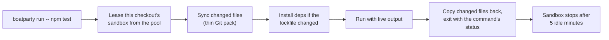

# boatparty

**Work here. Run afloat.** boatparty runs your Git project's builds, tests and dev servers on warm [boat.dev](https://boat.dev) Linux sandboxes instead of your laptop. You keep editing locally; boatparty mirrors your working tree, runs the command remotely with live output and its real exit code, and brings any changed files back.

```bash
boatparty run -- cargo test --locked
```

It was built for people working with several coding agents at once: every Git worktree gets its own warm sandbox from a small per-project pool, so agents can compile, test and serve in parallel while your computer stays cool.

**Documentation: [boatparty.ashray.xyz/docs](https://boatparty.ashray.xyz/docs)**

boatparty is for [boat.dev](https://boat.dev) users: it needs a boat account and drives boat's API. Other sandbox providers are not supported.

## Why boatparty

- **Warm by default.** Each checkout keeps its own sandbox, with dependencies installed and build outputs kept between commands. Only changed files are synced, and on a warm sandbox nothing talks to boat's API before your command starts, so a warm command often takes about a second.
- **Feels local.** Output streams live, stdout is passed through byte for byte, and files the command changes (formatter edits, lockfiles, generated code) come back to your working tree.
- **Exit codes you can trust.** You get the command's own exit status. `125` always means boatparty or the sandbox failed, never your tests.
- **Made for agents.** `--json` on every command with a tested contract, secrets on stdin with `pipe`, safe sharing of one checkout between agents, and a ready-made agent skill.
- **Careful with your account.** Sandboxes stop by themselves 5 minutes after the last command and keep their disk. Pools are capped, and every sandbox start goes through one ledger that respects boat's start limits. One file, `~/.config/boatparty/account.toml`, holds every limit for every project.
- **Recovers on its own.** Runs reconnect after an SSH drop and resume their output; stuck sandboxes are restarted from a snapshot or replaced.

## How a run works



## Install

**macOS or Linux** (arm64 or x86_64), with `git`, `ssh` and `ssh-keygen` on `PATH`:

```bash
curl -fsSL https://boatparty.ashray.xyz/install.sh | sh
```

This installs `boatparty` into `~/.local/bin`, verified against the release's `SHA256SUMS`. Run it again to upgrade.

**Windows** (x64 or Arm64), in PowerShell:

```powershell
irm https://boatparty.ashray.xyz/install.ps1 | iex
```

The Windows installer verifies the download, installs `boatparty.exe` in `%LOCALAPPDATA%\boatparty\bin`, adds it to your `PATH`, and offers to install Git for Windows, the OpenSSH Client and the boat CLI if they are missing.

More options (versions, directories, unattended installs): [Installation](https://boatparty.ashray.xyz/docs/installation).

## Quick start

With the [boat CLI](https://docs.boat.dev) installed and signed in:

```bash
boatparty login --create-key   # create a scoped boat API key and store it (it never touches argv or history)
boatparty doctor               # check tools, key and permissions; prints a fix for every failure
```

Then, in a Git repository with at least one commit:

```bash
boatparty init                 # write boatparty.toml for the detected stack (commit it)
boatparty run test             # the first run creates the sandbox; later runs reuse it warm
```

```text
boatparty: creating bp-hello-api-1 (default machine)
boatparty: ensure npm-install (first run)
...
✔ greets by name (0.445502ms)
✔ greets the crew (0.107676ms)
boatparty: applied the command's changes locally: package-lock.json
boatparty: bp-hello-api-1 (bx_d5zd8s2j) exit 0 in 8.7s (prep 8.1s, 0% CPU steal, started the sandbox)
```

The full walkthrough: [Your first run](https://boatparty.ashray.xyz/docs/getting-started).

## A short tour

```bash
# Run commands: an argument list, a shell line, or a name from boatparty.toml
boatparty run -- cargo test --locked
boatparty run --sh 'cargo test 2>&1 | tail -n 20'
boatparty run lint

# Run a dev server and open it on localhost
boatparty serve --forward auto:3000 -- npm run dev
boatparty url 3000                       # from another terminal or agent: http://localhost:51824
boatparty sync                           # push local edits to the running server

# Check exactly what you committed, on a dedicated sandbox
boatparty gate

# Secrets go on stdin, never in a command line
printf '%s\n' "$TOKEN" | boatparty pipe -- sh -c 'cat > ~/.app-token'
boatparty secret set --create DATABASE_URL < database-url.txt

# Look around
boatparty status                         # this project's sandboxes and servers
boatparty limits                         # starts left, running sandboxes, costs
boatparty log                            # recent runs
boatparty shell                          # a shell on the sandbox

# Teach a coding agent
boatparty skill                          # writes a SKILL.md and prints its path
```

| Command | Does |
| --- | --- |
| `run` | Sync, run one command, stream its output, return its exit code, bring its changes back |
| `serve` | Run a dev server with port forwards until cancelled |
| `url` | Print the local URL of a server running in this checkout |
| `gate` | Check a committed revision on a dedicated warm sandbox |
| `shell`, `pipe`, `fetch` | A shell or one command without syncing; a command fed from stdin; copy a file back |
| `sync`, `start`, `stop` | Sync only; start the sandbox now; stop it now (rarely needed) |
| `expose`, `forward`, `desktop` | A public HTTPS URL; a standalone port forward; the streamed Linux desktop |
| `secret`, `env` | Project secrets in a boat environment, and keeping sandboxes on the latest version |
| `base` | A saved snapshot new sandboxes start from, dependencies already built |
| `status`, `pool`, `limits`, `log`, `doctor` | What is running, what is left, what ran, what is wrong |

Every command has `--help`, and the [command reference](https://boatparty.ashray.xyz/docs/commands) covers every flag.

## Documentation

- **Start:** [What is boatparty?](https://boatparty.ashray.xyz/docs/overview) · [Installation](https://boatparty.ashray.xyz/docs/installation) · [Your first run](https://boatparty.ashray.xyz/docs/getting-started) · [Using boatparty with coding agents](https://boatparty.ashray.xyz/docs/coding-agents)
- **Concepts:** [How it works](https://boatparty.ashray.xyz/docs/how-it-works) · [Sync and copy-back](https://boatparty.ashray.xyz/docs/sync-and-copy-back) · [Pools and leases](https://boatparty.ashray.xyz/docs/pools-and-leases) · [Starts, limits and costs](https://boatparty.ashray.xyz/docs/limits) · [Reliability and recovery](https://boatparty.ashray.xyz/docs/reliability)
- **Guides:** [Running commands](https://boatparty.ashray.xyz/docs/running-commands) · [Dev servers, ports and URLs](https://boatparty.ashray.xyz/docs/dev-servers-and-urls) · [Sharing a workspace](https://boatparty.ashray.xyz/docs/sharing-a-workspace) · [Gate](https://boatparty.ashray.xyz/docs/gate) · [Base snapshots](https://boatparty.ashray.xyz/docs/bases) · [Secrets and environments](https://boatparty.ashray.xyz/docs/secrets-and-environments) · [GitHub access](https://boatparty.ashray.xyz/docs/github-access) · [Desktop](https://boatparty.ashray.xyz/docs/desktop) · [Windows](https://boatparty.ashray.xyz/docs/windows) · [Troubleshooting](https://boatparty.ashray.xyz/docs/troubleshooting)
- **Reference:** [Commands](https://boatparty.ashray.xyz/docs/commands) · [boatparty.toml](https://boatparty.ashray.xyz/docs/configuration) · [Presets and steps](https://boatparty.ashray.xyz/docs/presets) · [account.toml](https://boatparty.ashray.xyz/docs/account-file) · [JSON output](https://boatparty.ashray.xyz/docs/json) · [Exit codes](https://boatparty.ashray.xyz/docs/exit-codes) · [Files and variables](https://boatparty.ashray.xyz/docs/files-and-variables)
- **Project:** [Releases and builds](https://boatparty.ashray.xyz/docs/releases) · [Changelog](https://boatparty.ashray.xyz/docs/changelog)

## Development

The maintainers run every check on a boat sandbox through boatparty itself, so nothing compiles on their machines; without a boat account, `just check` runs the same gate locally and CI runs it on every push. See [`CONTRIBUTORS.md`](CONTRIBUTORS.md).

```bash
just remote-check        # the full gate: fmt, clippy, tests, shellcheck, docs
just remote-test pipe    # cargo test with a filter
```

[`AGENTS.md`](AGENTS.md) has the module map and conventions, [`docs/json.md`](docs/json.md) the `--json` contract, and [`docs/boat-facts.md`](docs/boat-facts.md) the measured boat behavior the design relies on. The docs site lives in [`docs/`](docs/).
