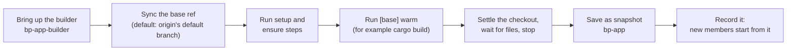

Every new sandbox starts empty. Its first command has to receive the whole project, install every dependency and build everything from scratch. For a small project that takes seconds. For a large Rust workspace or a big monorepo it can take many minutes, and it happens again every time the pool grows or a sandbox is replaced.

A **base** fixes that. It is a saved snapshot of a fully warmed-up sandbox: project synced, dependencies installed, code compiled. New members start from it and only need to catch up on what changed since.

The base is optional. Without one, everything still works; new sandboxes are just slower on their first command.

## Building a base

```bash
boatparty base build
```

`base build` does this:



1. Brings up the project's **builder** sandbox, `bp-<project>-builder`. The builder is never leased to a workspace, does not count against `max_sandboxes`, and is kept stopped between builds, so the next build is incremental too.
2. Syncs the **base ref** in the project's history mode. By default that is the repository's default remote branch (`origin/HEAD`, else `origin/main` or `origin/master`), or HEAD if there is no remote. Set `[base] ref` to choose another.
3. Runs the setup and ensure steps (installing dependencies).
4. Runs the `[base] warm` command, which builds everything the usual commands build. Each built-in preset has one; for example the `rust` preset runs `cargo build --all-targets` and `cargo test --no-run`.
5. Settles the checkout, waits until the builder's files are completely stored, and stops it.
6. Saves it at boat as the snapshot `bp-<project>`.

The new base is recorded only once the snapshot is ready, so a failed build leaves the previous base in use. The builder gets no account secrets, and no credential is ever written to its disk, so the snapshot is safe to start other sandboxes from.

## What a base changes

A member created while the project has a base starts from that snapshot instead of an empty machine:

- Dependencies are already installed; ensure steps see unchanged inputs and skip.
- Build outputs are already there, so the first build is incremental.
- The first sync sends only what changed since the base commit, not the whole project.

Members that already exist are not affected; they keep their own warm state. A base mainly speeds up pool growth, new worktrees, and replacement after [recovery](/docs/reliability#the-recovery-ladder).

## Checking how fresh it is

```bash
boatparty base status
```

Without a base:

```text
project hello-api has no base
new sandboxes build their dependencies on their first command; `boatparty base build` saves a base they start from instead
saved snapshots: 5 used of 10 included
```

With one, it reports the snapshot, the ref and commit it was built from, its age and size, how many commits the ref has gained since, and whether any of its **stale inputs** changed:

```text
base bp-app: origin/main at 4c1e9a2b1f (head history), built 2 days ago, 1.8 GiB
12 commits behind origin/main; changed: Cargo.lock
stale: Cargo.lock changed since the base; `boatparty base build` refreshes it
saved snapshots: 6 used of 10 included
```

A base is **stale** when any of these is true:

- a file listed in `[base] stale_inputs` (typically lockfiles) differs between the base commit and the ref;
- the ref is `max_commits_behind` commits or more ahead (default 50);
- the base is `max_age_hours` old or older (default 168, one week);
- the base commit is missing from your local repository.

Staleness is judged with local refs only. Run `git fetch` first if you want it compared with the latest upstream branch. `boatparty status` also mentions the base, and the snapshot allowance of your boat plan is shown at the end.

## Refreshing it automatically

You can let boatparty rebuild a stale base in the background:

```toml
[base]
auto_refresh = true       # default false
max_commits_behind = 50
max_age_hours = 168
```

With `auto_refresh` on, whenever a new member is created from the base, boatparty checks the base's freshness in a detached helper process, and if it is stale, starts one background `base build`. The command that created the member does not wait; it carries on immediately. New members keep using the current base until the rebuild finishes and replaces it.

The background refresh uses the builder, the normal start ledger, reserves and running limits, like a manual build. You can follow it in:

- `boatparty base status` and `boatparty status`, which report a refresh in progress and the last refresh failure;
- the log file `base-refresh-<project>.log` in boatparty's state directory, with timestamps and outcomes.

A first base must still be built by hand with `boatparty base build`; auto-refresh only refreshes an existing one.

## Removing a base

```bash
boatparty base rm                  # delete the snapshot, its record and the builder
boatparty base rm --keep-builder   # keep the stopped builder, so a later build is incremental
```

New members then start empty again. Existing members are not affected.

## Configuring the base

All in `boatparty.toml` (or a preset), under `[base]`:

| Key | Default | Meaning |
| --- | --- | --- |
| `warm` | from the preset | Shell commands that build everything, run after the steps |
| `stale_inputs` | from the preset | Files whose change makes the base stale, usually lockfiles |
| `ref` | the default remote branch, else HEAD | The Git ref the base is built from |
| `auto_refresh` | `false` | Rebuild a stale base in the background after a member is created from it |
| `max_commits_behind` | 50 | Commits behind the ref that make the base stale |
| `max_age_hours` | 168 | Age in hours that makes the base stale |

A `warm` command that should do nothing in some checkouts can exit early, as the built-in ones do:

```toml
[base]
warm = '''
[ -f Cargo.toml ] || exit 0
cargo build --locked --all-targets
cargo test --locked --no-run
'''
stale_inputs = ["Cargo.lock", "rust-toolchain.toml"]
```

## When a base is worth it

| Project | Base? |
| --- | --- |
| Small project, dependencies install in seconds | Not needed |
| Large Rust, C++ or Go build | Yes: the first build on a new member is the slow part |
| Monorepo with heavy `node_modules` | Yes |
| Many short-lived worktrees (agents) | Yes: each new worktree may need a new member |
