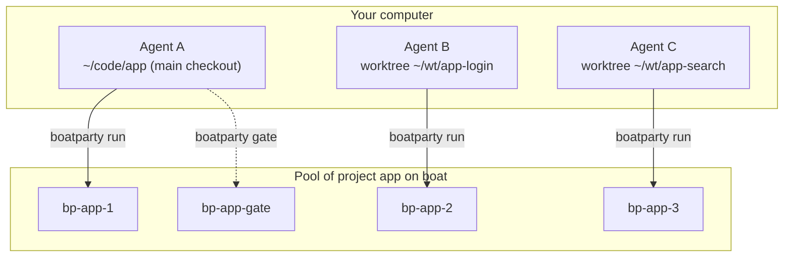
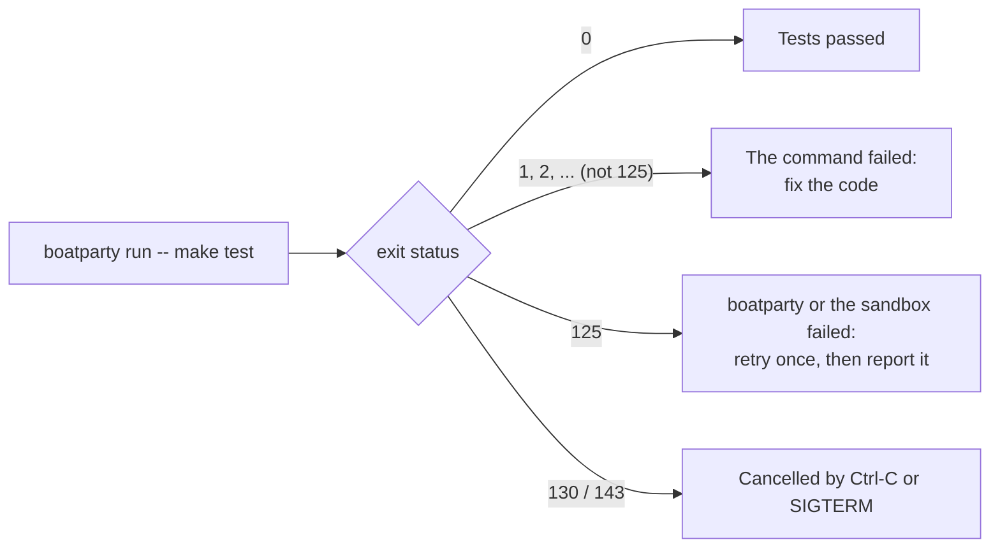

boatparty was designed for a person working with several coding agents at once. Each agent works in its own Git worktree, and each worktree gets its own sandbox, so the agents can compile, test and run servers in parallel without fighting over your computer's CPU, memory or ports.

This page explains how to set that up and what an agent needs to know to use boatparty well.

## The setup in one picture



- Every worktree is a separate **workspace**, and keeps using the same sandbox for as long as it exists. Dependencies and build outputs stay warm there between commands.
- All the worktrees share one `boatparty.toml` (it is committed), one pool and one set of limits.
- A project's pool holds at most `max_sandboxes` members (8 by default). A ninth worktree waits for a free one or borrows an idle one; see [Pools and leases](/docs/pools-and-leases).

## Install the skill

boatparty ships a skill: a `SKILL.md` file that teaches an agent the commands, the exit-code contract and the cautions on this page. The skill always matches the installed version of boatparty.

```bash
boatparty skill
```

```text
/Users/you/.local/state/boatparty/skill/boatparty/SKILL.md
boatparty: this skill teaches coding agents to use boatparty; copy /Users/you/.local/state/boatparty/skill/boatparty into an agent's skills directory only if the user asks for it
```

`boatparty skill` writes the file and prints its path. It installs nothing on its own. Copy the directory into your agent's skills directory, for example:

```bash
# Claude Code (personal skills)
cp -R ~/.local/state/boatparty/skill/boatparty ~/.claude/skills/

# Or print it and paste it wherever your agent reads instructions
boatparty skill --print
```

Run `boatparty skill` again after each upgrade and copy it over the old one, so the agent's instructions match the binary.

## The rules agents should follow

The skill teaches these, but they are worth knowing yourself.

### Exit code 125 is infrastructure, not code



`run`, `serve`, `pipe`, `gate` and `shell -- CMD` exit with the remote command's own status. Only 125 is reserved: it means boatparty, the connection or the sandbox failed, and the command's result is unknown. An agent should retry once, and if it fails again, report it as an infrastructure problem rather than a failing test. The message on stderr says what went wrong. [Exit codes and errors](/docs/exit-codes) lists every code.

### stdout belongs to the command

boatparty never writes to stdout during `run`; everything it says goes to stderr, prefixed `boatparty: `. An agent can therefore pipe or parse a command's stdout exactly as if it had run locally. For structured results, put `--json` before the command:

```bash
boatparty --json run -- npm test
```

Each line is then a JSON frame (`stdout`, `stderr`, `event`), ending with one `result` frame that holds the exit code, timings and copy-back outcome. See [JSON output](/docs/json).

### Edit locally, run remotely

Agents should edit files in their worktree as usual. The next `run` syncs the changes. Files that the command creates or modifies in the checkout come back automatically, so formatters and code generators work as they would locally. Ignored files (like `target/` or `node_modules/`) never travel in either direction; use `boatparty fetch` to bring a build output back. See [Sync and copy-back](/docs/sync-and-copy-back).

### Long-running servers belong in the background

`boatparty serve` runs until it is cancelled. An agent should start it with whatever background process tool its harness offers, not as a blocking command, then use `boatparty url PORT` to find the local URL. See [Dev servers, ports and URLs](/docs/dev-servers-and-urls).

### Never put secrets in a command line

A command line is recorded in `runs.jsonl` and visible in process lists. Pass secrets on standard input with `pipe`, which records nothing of its input:

```bash
printf '%s\n' "$TOKEN" | boatparty pipe -- sh -c 'cat > ~/.app-token'
```

For values every command needs, use project secrets (`boatparty secret set`). See [Secrets and environments](/docs/secrets-and-environments).

### Do not stop sandboxes between commands

Every create or resume of a sandbox is a *start*, and a boat account has a limited number per minute, hour and day. A sandbox stops by itself 5 minutes after its last command and costs nothing while stopped. Stopping it early only makes the next command pay for another start. Agents should also avoid starting a sandbox just to check that it works. `boatparty limits` shows what is left. See [Starts, limits and costs](/docs/limits).

### Leave destructive commands to people

`rm`, `pool prune`, `base rm` and `limits set` delete sandboxes or change account-wide limits. The skill tells agents not to run them unless the user asks.

## Several agents in one worktree

Sometimes two agents share one checkout, for example one running a dev server while another runs tests. boatparty handles that safely: runs take turns, a server can keep running beside other commands, and any agent can find the server's URL with `boatparty url`. [Sharing a workspace between agents](/docs/sharing-a-workspace) explains the rules.

## Checking finished work

When an agent finishes a change, `boatparty gate` checks the committed code on a separate, dedicated sandbox, without disturbing the agent's own sandbox or uncommitted files:

```bash
boatparty gate                       # check HEAD with the project's [gate] command
boatparty gate --default-branch      # check the default branch
```

See [Checking commits with gate](/docs/gate).

## A sample instruction block

If your agent does not support skills, a few lines in its project instructions (such as `AGENTS.md` or `CLAUDE.md`) go a long way:

```markdown
## Builds and tests

Run builds, tests and servers on boat with boatparty, never locally:

- `boatparty run -- <command>` runs a command; `boatparty run test` runs the test suite.
- Exit 125 means boatparty or the sandbox failed, not the code: retry once, then report it.
- Start dev servers in the background with `boatparty serve --forward auto:3000 -- npm run dev`,
  then get the URL with `boatparty url 3000`.
- Pass secrets on stdin with `boatparty pipe`, never in a command line.
- Do not run `boatparty stop`, `rm`, `pool prune` or `limits set` unless asked.
```
