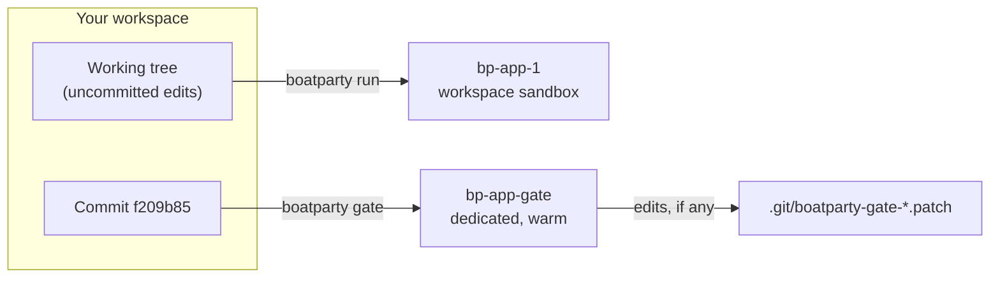

`boatparty run` tests your working tree as it is right now, uncommitted edits included. That is what you want while you work. But before you push or merge, you usually want to know whether **the commit itself** passes: no stray local files, no half-finished edits, exactly what others will get.

`boatparty gate` does that. It checks a committed revision on a separate sandbox reserved for the purpose, the **gate member** (`bp-<project>-gate`), and leaves your workspace and its sandbox alone.

```bash
boatparty gate
```

```text
boatparty: ensure npm-install (first run)
...
✔ greets by name (0.409806ms)
✔ greets the crew (0.08539ms)
ℹ tests 2
ℹ pass 2
ℹ fail 0
boatparty: bp-hello-api-gate checked f209b85b12171e75321dc3695a37f2ff6fe87a49 (exit 0)
```

`gate` exits with the check's exit code, so it slots into scripts and agent workflows just like `run`.

## Choosing the check

By default, `gate` runs the `[gate] command` from `boatparty.toml`:

```toml
[gate]
command = "make check"
```

You can also give the command directly, in the same forms as `run`:

```bash
boatparty gate test                 # a [commands] entry or package script, with arguments
boatparty gate -- make check        # an argument list
```

If there is no `[gate] command` and you give none, `gate` fails and tells you to set one.

## Choosing the commit

```bash
boatparty gate                          # HEAD (the default)
boatparty gate --commit HEAD~1          # any revision Git understands
boatparty gate --commit feature/login   # a branch
boatparty gate --default-branch         # the default branch
```

`--default-branch` uses the default remote branch your repository knows locally (such as `origin/main`), falling back to a local `main` or `master`. It does not fetch: run `git fetch` first if you want the latest upstream commits.

The selected commit supplies everything: the source files, the `boatparty.toml` (including `[gate] command`) and the project's presets in `.boatparty/presets/`. Uncommitted edits, untracked files and local changes to `boatparty.toml` are not used. Your user presets in `~/.config/boatparty/presets/` and the built-in presets still apply.

## How the gate member works



- **It is dedicated.** The gate member only ever runs gates (and `pipe --gate` or `shell --gate`). It is never leased to a workspace, so it never has someone else's half-built tree.
- **It stays warm.** Like any member, it keeps dependencies and build outputs, and stops after `idle_minutes`. Repeated gates are incremental.
- **It is reset after each check.** After the command, the checkout is reset to a clean state. Ignored caches (`target/`, `node_modules/`) are kept, so the next gate is still fast.
- **It is independent of the workspace.** A gate does not wait for runs, syncs or servers in your workspace, and they do not wait for it.
- **One at a time.** Only one gate can use the project's gate member at once. A second concurrent gate fails with `gate_busy`.
- **It counts toward your limits.** The gate member occupies one slot of `max_sandboxes`, and its starts go through the start ledger and count toward running limits like any other.

## When the check changes files

Some checks modify files: a formatter in check mode that writes anyway, a code generator, a snapshot update. A gate never writes into your working tree. Instead, if the check changed anything in the checkout, boatparty saves the changes as a binary-safe patch in your Git directory and tells you where:

```text
boatparty: gate changes saved to /Users/you/code/app/.git/boatparty-gate-3f9c1a2b.patch
```

Look at it, and apply it if you want the changes:

```bash
git apply --stat .git/boatparty-gate-3f9c1a2b.patch
git apply .git/boatparty-gate-3f9c1a2b.patch
```

With `--json`, the result frame's `patch` field holds the path (or `null` when nothing changed).

## Preparing files for a gate

Some checks need a file that is not in the repository, such as a fixture or a credential. Use `pipe --gate` to write it on the gate member, and `shell --gate` to look around:

```bash
boatparty pipe --gate --sh 'cat > ~/fixture.json' < fixture.json
boatparty shell --gate -- ls -l ~/fixture.json
```

Files outside the checkout (like `~/fixture.json`) persist on the gate member. Files inside the checkout follow the gate's normal sync rules and are replaced or cleaned by the next gate.

## Removing the gate member

Like any member, the gate member can be deleted by name. The next `gate` creates a fresh one:

```bash
boatparty rm bp-app-gate
```

## Gate in an agent workflow

`gate` is a good final step for an agent before it reports work as done:

```bash
git commit -am "Add login form"
boatparty gate || echo "the committed code fails its checks"
```

Because the gate member is separate, an agent can gate its commit while its dev server keeps running in the same worktree.
