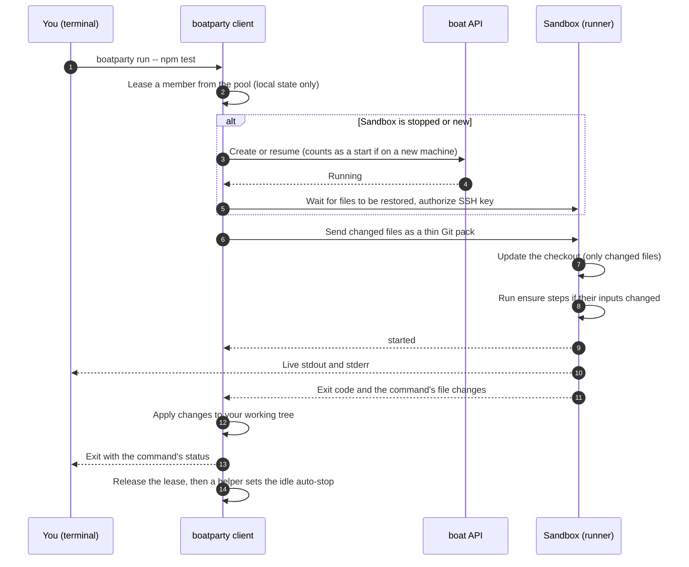
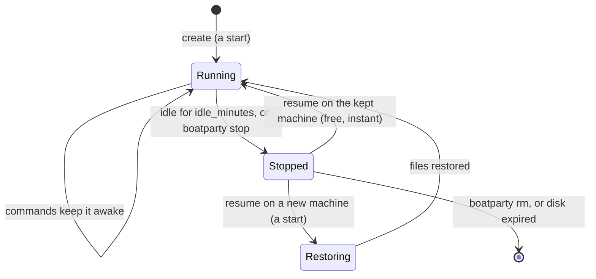

This page follows a single `boatparty run` through every stage, then looks at how a sandbox lives between commands. You do not need any of this to use boatparty, but it explains the messages you will see, why warm commands take about a second, and why boatparty is careful about starting sandboxes.

## The two halves

boatparty has two parts:

- **The client** is the `boatparty` binary on your computer. It reads your configuration, talks to boat's API, keeps local records of your sandboxes, and connects to sandboxes over SSH.
- **The runner** is a bash script that the client uploads to each sandbox (to `/home/user/.boatparty/bin/`, named after a hash of its content) and runs there. It applies the synced files, runs preparation steps, starts your command, watches it, and reports the result.

Because the runner is uploaded under its content hash, the sandbox always runs the exact version that matches your client. Upgrading boatparty never leaves an old runner behind on a sandbox.

## One run, step by step

### 1. Find the project and lease a sandbox

boatparty finds the Git top-level directory you are in (the **workspace**), reads `boatparty.toml` and resolves the presets, and loads your account's limits from `account.toml`.

It then takes a **lease** on a member of the project's pool. A lease is a record in boatparty's local state file that says "process 12345 is using `bp-app-1`". The workspace normally gets the same member it used last time, so its dependencies and build outputs are already there. If that member is taken or gone, boatparty picks another one using the rules in [Pools and leases](/docs/pools-and-leases).

### 2. Bring the sandbox up, if needed

If the member is already running and boatparty has a live SSH connection to it, this step is skipped entirely: **nothing talks to boat's API before your command starts.** This is the warm path, and it is why a warm command often finishes in about a second.

Otherwise boatparty creates the sandbox (for a new member) or resumes it (for a stopped one), waits for it to run, authorizes boatparty's own SSH key, and pins the sandbox's host key so later connections are verified. You will see a line like `boatparty: creating bp-app-1 (default machine)` or `boatparty: resuming bp-app-1`.

A resumed sandbox sometimes lands on a new physical machine. Its disk then arrives lazily in the background (boat calls this *hydration*), and boatparty waits until the restore is complete before syncing, printing progress once a minute. [Reliability and recovery](/docs/reliability) covers what happens when a restore is slow or stuck.

### 3. Sync the working tree

boatparty takes a snapshot of your working tree into a private Git index (it never touches your real index or files), and sends the sandbox only the objects it lacks as a thin Git pack. The runner then makes the sandbox's checkout match your working tree, rewriting only files whose content changed. [Sync and copy-back](/docs/sync-and-copy-back) explains this in detail.

### 4. Prepare

Before the command, the runner applies your project's settings:

- **Setup steps** (`[[setup]]`) run before the first command of each boot of the sandbox's machine (and again when the steps themselves change), unless their `check` passes.
- **Ensure steps** (`[[ensure]]`) run when their inputs changed since they last succeeded, typically a lockfile. This is how `npm ci` or `cargo fetch` runs only when `package-lock.json` or `Cargo.lock` changes.
- **Environment variables** from `[run.env]` are exported, along with your Git identity and, if enabled, a GitHub token.

Step output goes to stderr, so stdout still belongs only to your command. If a step fails, the run ends with that step's exit code and your command does not run. See [Presets and steps](/docs/presets).

### 5. Run the command

The runner starts your command in its own process group, in the sandbox's checkout (`/home/user/<project>` by default). Output streams back to your terminal as it is produced. While the command runs, a background heartbeat keeps pushing the sandbox's auto-stop deadline forward, so a long build is never stopped halfway.

The command keeps running on the sandbox even if your SSH connection drops. boatparty reconnects for up to ten minutes and resumes the output from the last byte it received. If your client never comes back, the sandbox stops the command after ten minutes on its own.

Ctrl-C (or SIGTERM) cancels the remote command too, and boatparty exits with 130 (or 143).

### 6. Copy back

When the command ends, the runner compares the checkout with the tree it received and sends back the difference as a patch. boatparty applies it to your working tree, so a formatter's edits or a regenerated file appear locally. If you edited the same lines in the meantime, nothing is touched and the patch is saved for you to look at.

### 7. Release and go idle

boatparty records the run in `runs.jsonl`, releases its lease and exits with the command's status. A small detached helper process then sets the sandbox's idle deadline: if no other command uses it within `idle_minutes` (5 by default), boat stops it. boatparty never stops a sandbox itself in this path; boat's auto-stop is the only thing that does.

## A sandbox between commands

- **Running.** The sandbox is up and costs machine time. Every command pushes its auto-stop deadline forward while it runs.
- **Stopped.** The sandbox's disk is kept and it costs nothing to keep. Processes are gone, but every file in your checkout, installed dependency and build output is still there.
- **Resuming.** If boat can give the sandbox back its previous machine, the resume is immediate and does not count as a start. If the machine was reused, boat resumes it on a new one, counts a start, and restores the disk in the background.

Some locations do not survive a move to a new machine, notably `~/.cache`, `/tmp` and `/var/tmp`. The built-in presets keep caches elsewhere (for example under `/home/user/.boatparty/cache/`) for exactly this reason.

## Why it is designed this way

- **Warm by default.** Each workspace keeps its own sandbox with its dependencies and build outputs, so most commands are incremental. A fresh sandbox per command would pay for installs and full rebuilds every time.
- **Nothing on the critical path.** The warm path is local state, one SSH connection and one round trip. Updating boat's auto-stop deadline takes about as long as a whole warm command, so boatparty does it in the background.
- **Content, not timestamps.** Only files whose content changed are rewritten, so build tools see stable modification times and do not rebuild unchanged code.
- **Starts are precious.** Boat limits how many sandboxes you can start per minute, hour and day. Idle sandboxes stop rather than being deleted, and boatparty routes every start through one ledger. See [Starts, limits and costs](/docs/limits).
- **The exit code is sacred.** The command's own status always comes back. boatparty's own failures use 125, a code ordinary commands rarely use.
