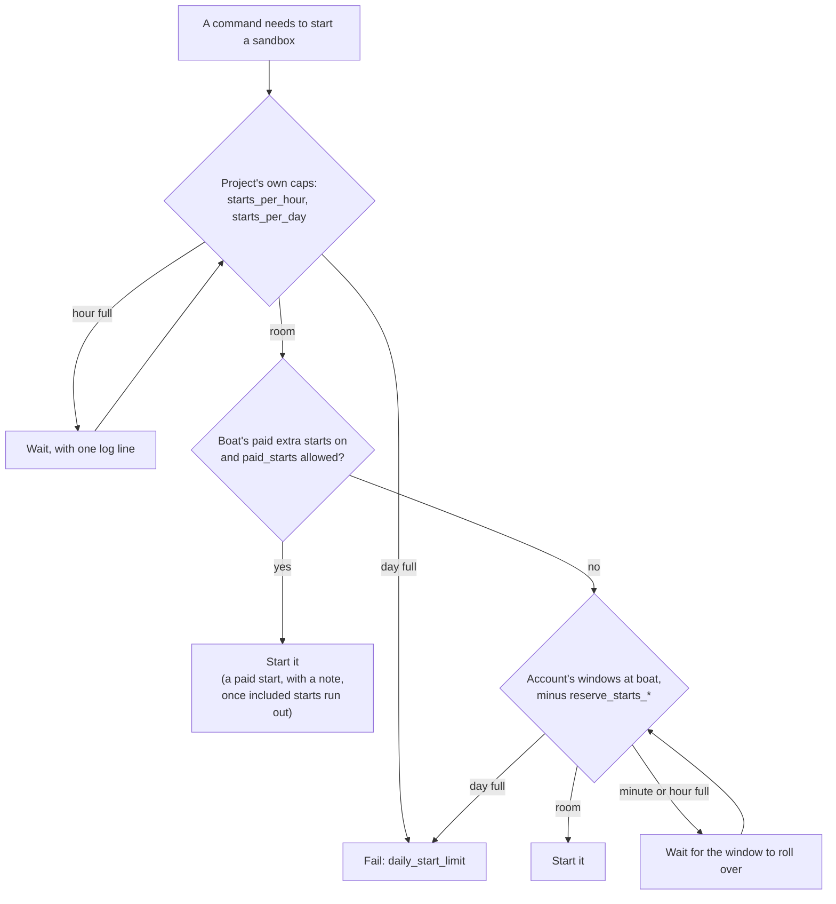

Running sandboxes costs machine time, and starting them is limited. boatparty is built to use both carefully, so that a handful of agents running all day does not exhaust your boat account. This page explains what is limited, how boatparty stays inside the limits, and how to change them.

All of boatparty's limits for every project live in one file, `~/.config/boatparty/account.toml`. `boatparty limits` shows where you stand, and `boatparty limits set` changes a limit without disturbing the file's comments.

## Starts are the scarce resource

Boat counts a **start** every time it creates a sandbox, and every time it resumes a stopped sandbox onto a new machine. It allows a fixed number of starts per rolling minute, hour and day (for example 12, 60 and 200), and it never queues a start: past the limit, it refuses.

A resume that gets the sandbox's previous machine back is **free**: it is instant and does not count. That is common when a sandbox was stopped recently.

Because a day's starts are shared by everything on the account (boatparty, CI, the boat CLI, other machines), boatparty treats them as precious:

- Idle sandboxes **stop** instead of being deleted, so the next command resumes them, often for free.
- A warm workspace reuses its own running sandbox, which costs no start at all.
- Every start on this computer goes through one **start ledger**, shared by all projects, that checks the limits before asking boat.

The most useful habit follows from this: **do not stop sandboxes between commands.** A stopped sandbox costs nothing anyway, and stopping one early only makes the next command pay for a start.

## The start ledger



Before every create or resume, boatparty asks the ledger:

1. **The project's own caps.** If the project set `starts_per_hour` or `starts_per_day` and the window is full, the start waits (for the hour) or fails (for the day).
2. **The account's windows at boat**, minus the reserves you set. `reserve_starts_per_hour` and `reserve_starts_per_day` leave that many starts unused for other tools and for starts you make by hand.
3. If a minute or hour window is full, the start **waits** until it rolls over, with one log line saying why and roughly how long. If the day window is full, it **fails at once** with `daily_start_limit`, because waiting hours would not help anyone.

A start that cannot be admitted within 65 minutes fails with `admission_timeout`. If boat itself refuses with a rate limit for the minute or hour window, boatparty retries after the delay boat names.

### Paid starts

When boat's extra starts are turned on for the account (`boat billing extra-starts on`), boat bills a start past the plan's included starts (a few cents each, up to a monthly cap) instead of refusing it. boatparty then starts anyway and tells you:

```text
boatparty: starting bp-app-2 is a paid start (about $0.03 on boat's next invoice): the account's included starts are used up and its extra starts are on; set `[account] paid_starts = false` in /Users/you/.config/boatparty/account.toml to never pay
```

With paid starts, the account's reserves no longer hold a start back, but each project's own caps still do, and boat still refuses past its hard caps. To make boatparty never use a paid start:

```bash
boatparty limits set account paid_starts=false
```

### Included VM time

Boat plans include some machine time. When it is used up, machine time is billed. boatparty notices this when it creates or resumes a sandbox and prints a note once per project per UTC day:

```text
boatparty: included VM hours used up until 2026-12-11; runtime is billed
```

## Idle sandboxes stop by themselves

A running sandbox costs machine time; a stopped one does not. boatparty never leaves a sandbox running for long without a reason:

- **While a command runs**, its lease keeps the sandbox's auto-stop deadline `lease_minutes` (5) ahead, renewed every `heartbeat_minutes` (2).
- **After the last command ends**, the sandbox stops `idle_minutes` (5) later, unless another command arrives.
- **If a client dies** (crash, SIGKILL, laptop lid closed), nothing renews the deadline, so the sandbox stops within about `lease_minutes`.
- **While a resumed sandbox is still restoring its files**, boatparty never lets it stop: its idle deadline is pushed past the restore, so the next command does not have to start over.

The deadline lives at boat, not on your computer, so a sandbox stops on time even if your computer is off.

| Key | Default | Maximum | Meaning |
| --- | --- | --- | --- |
| `lease_minutes` | 5 | 5 | While a command runs, the auto-stop stays this far ahead |
| `heartbeat_minutes` | 2 | below `lease_minutes` | How often a running command pushes the auto-stop forward |
| `idle_minutes` | 5 | 15 | After the last command ends, the sandbox stops this much later |

The maximums are deliberate: a forgotten sandbox should never keep billing for long.

## Running sandboxes

`max_running` caps how many sandboxes run at once, for the whole account (`[account] max_running`) and per project (`[projects.NAME] max_running`). Neither is set by default, so only boat's own concurrency limit applies.

At the cap, boatparty does not start another sandbox. It reuses a running sandbox that no command is using at that moment (even one another workspace used recently), and otherwise waits for one to stop or free up. If the cap stays reached for the whole wait, the command fails with `running_limit`.

## Machine sizes

New sandboxes use the `machine` size from `[defaults]` (`default`). A project can ask for another size in `boatparty.toml` (`[sandbox] machine`): `small`, `default`, `large` or `xlarge`, depending on what your boat plan allows. A project's `max_machine` in `account.toml` caps what its `boatparty.toml` may ask for, and asking for more is an error that names both files. `boatparty limits` lists the sizes your plan offers.

## Reading the limits

```bash
boatparty limits
```

```text
starts         used   left  limit
  minute          1     11     12
  hour            9     51     60
  day            62    138    200
sandboxes    4 running of at most 100
included VM  0.0 of 555.6 hours left, until 2026-12-11 (hours of a default machine)
sizes        small, default, large; not available: xlarge (needs the $100/month plan or higher)
can start    yes
account      max_running unset; reserve 0 starts/hour, 0 starts/day; paid starts allowed; boatparty started 2 in the last hour, 2 in the last day

PROJECT    MEMBERS  RUNNING  STARTS HOUR  STARTS DAY  MACHINE  IDLE/LEASE  COST THIS MONTH
hello-api  2/8      2        2            2           default  5m/5m       $0.00 (0.0 h)
```

The top half comes from boat and covers the whole account: starts used in each rolling window, running sandboxes, included VM time and machine sizes. `can start` says whether the next start would succeed (and whether it would be paid). The table below lists each project on this computer with its members, running sandboxes, recent starts, machine size, idle and lease times, and this month's machine cost.

### The start ledger in detail

```bash
boatparty limits starts
```

```text
window   boatparty        account elsewhere  boatparty's next start leaves
minute           1           1/12         0  in 50s
hour             2           9/60         7  in 58m
day              2         62/200        60  in 23h58m
(account: every start boat counted; elsewhere: those boatparty did not make, such as CI or other tools)

project                      1m     1h    24h
hello-api                     1      2      2

starts per hour, 24h ago to now: 0 0 0 0 0 0 0 0 0 0 0 0 0 0 0 0 0 0 0 0 0 0 0 2
the last 2 of 2 (UTC):
  2026-11-26T18:30:43Z  hello-api
  2026-11-26T18:31:58Z  hello-api

boatparty's starts leaving the 24h window (cumulative): +1h 0, +2h 0, +4h 0, +6h 0, +12h 0, +24h 2
```

This shows boatparty's own starts in each rolling window next to the account's totals from boat. The `elsewhere` column is the gap: starts made by CI, other tools or other computers. Below that are the per-project counts, an hourly timeline, each start's time, and how many of boatparty's starts leave the day window over the coming hours, so you can plan around the rolling limits.

## Changing limits

`limits set` edits `account.toml` in place, keeping its comments and layout:

```bash
boatparty limits set account max_running=4 reserve_starts_per_day=20
```

```text
[account] max_running: unset -> 4
[account] reserve_starts_per_day: 0 -> 20
saved /Users/you/.config/boatparty/account.toml
```

```bash
boatparty limits set project app starts_per_hour=10 max_machine=default
boatparty limits set project app max_running=        # an empty value removes the key
```

`limits set account` accepts the `[account]` keys (`max_running`, `reserve_starts_per_hour`, `reserve_starts_per_day`, `paid_starts`) and the `[defaults]` keys (`machine`, `max_sandboxes`, `steal_after_minutes`, `lease_minutes`, `idle_minutes`, `heartbeat_minutes`, `acquire_wait_seconds`). `limits set project NAME` accepts `max_sandboxes`, `max_running`, `max_machine`, `starts_per_hour`, `starts_per_day`, `idle_minutes` and `lease_minutes`. An unknown key or a bad value fails with `invalid_limit` and changes nothing.

You can also edit the file by hand. Unknown keys are an error, so a typo never silently does nothing. The full list of keys is in [account.toml](/docs/account-file).

## A sensible setup for several agents

For one person running a few agents on one account, a setup like this keeps costs and surprises low:

```toml
[account]
max_running = 6               # never more than six machines at once
reserve_starts_per_day = 20   # leave room for CI and manual work
# paid_starts = false         # uncomment to never pay for an extra start

[projects.app]
max_sandboxes = 6             # one per agent worktree, plus spares
starts_per_hour = 20          # a runaway script cannot burn the hour
```
