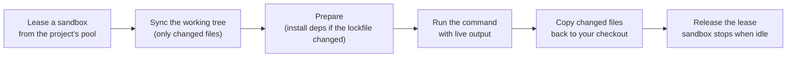

boatparty is a command-line tool that moves the heavy part of software work (compiling, testing and running servers) off your computer and onto [boat.dev](https://boat.dev) Linux sandboxes. You keep editing files locally, in your own editor, in your own Git checkout. When you want to build or test, you put `boatparty run` in front of the command:

```bash
boatparty run -- cargo test --locked
```

That single command copies your working tree to a sandbox, runs `cargo test` there with its output streaming to your terminal, exits with the test suite's real exit code, and brings back any files the command changed. The sandbox then stays warm for your next command, and stops by itself a few minutes after you go quiet.

## Why it exists

Coding agents changed how many builds a single laptop is asked to run. One person with three or four agents, each in its own Git worktree, can easily start four Rust compiles, two test suites and a couple of dev servers at once. A laptop handles that badly: fans spin, everything slows down, and the agents' timings become unreliable.

boatparty gives every checkout its own Linux machine instead. Each worktree leases its own sandbox from a small pool that belongs to the project, so agents can compile, test and serve side by side while your computer stays cool and responsive.

It is also careful with the things that cost money or are scarce on boat. Sandboxes stop when idle, the number of sandboxes per project is capped, and every sandbox start goes through one ledger so boatparty never burns through your account's start allowance by surprise. You can read more about that in [Starts, limits and costs](/docs/limits).

## Who it is for

boatparty is for [boat.dev](https://boat.dev) users. It needs a boat account and talks to boat's API; it does not support other sandbox providers.

It works well for people, but it was designed first for coding agents, which need a few guarantees that ordinary remote-build tools rarely give:

- **Exit codes you can trust.** A command's own exit status comes back unchanged. When boatparty itself fails (a lost connection, a missing key, a limit), it exits with `125` instead, so an agent can tell "your tests failed" apart from "the infrastructure failed".
- **Clean output.** The command's stdout passes through byte for byte. boatparty's own messages go to stderr, each prefixed with `boatparty: `.
- **Machine-readable results.** Every command accepts `--json`, with a documented, tested contract.
- **Secrets stay out of logs.** `boatparty pipe` feeds input to a remote command on stdin, so tokens never appear in a command line, a log or a state file.
- **A ready-made skill.** `boatparty skill` writes a skill file that teaches an agent how to use boatparty.

[Using boatparty with coding agents](/docs/coding-agents) covers all of this in detail.

## What happens on a command

Here is the life of one `boatparty run`, from the moment you press Enter to the moment your prompt comes back:



1. **Lease.** Your checkout takes a sandbox from the project's pool: the one it used last if possible. If that sandbox is already running, boatparty does not even talk to boat's API before your command starts.
2. **Sync.** Your working tree (tracked and untracked files, minus anything Git ignores) travels to the sandbox as a compact Git pack. Only files whose content changed are rewritten, so build tools see unchanged timestamps and do not rebuild needlessly.
3. **Prepare.** If your lockfile changed, the project's dependency step (for example `npm ci` or `cargo fetch`) runs first. Otherwise this step is skipped.
4. **Run.** The command runs in the sandbox's copy of your repository, with output streaming to your terminal as it happens.
5. **Copy back.** Files the command created or changed (a formatter's edits, generated code, a new lockfile) are applied to your local working tree.
6. **Idle.** When no command is using the sandbox, it stops by itself after 5 minutes. Its disk is kept, so the next command resumes exactly where you left off.

[How boatparty works](/docs/how-it-works) goes through each of these steps in depth.

## The sandboxes

Every sandbox is a Linux x86_64 machine running Ubuntu 24.04 with boat's standard tool image: Git, compilers and runtimes for the common stacks (Rust, Node.js, Bun, pnpm, Python, Go and more). It does not matter whether your own computer is a Mac, a Linux box or a Windows PC; the commands always run on the same Linux environment.

By default, sandboxes are created without any of your boat account's stored secrets. A project can opt in to a boat environment when it needs variables or secret files; see [Secrets and environments](/docs/secrets-and-environments).

## The words boatparty uses

You will see these terms throughout the docs and in boatparty's own messages.

| Word | Meaning |
| --- | --- |
| **Project** | A named unit with its own pool and limits. The name comes from `boatparty.toml` at the root of the repository. |
| **Workspace** | One checkout of a project on your computer, identified by its Git top-level directory. Each Git worktree is a separate workspace. |
| **Pool** | The set of sandboxes a project owns, capped by `max_sandboxes` (8 by default). |
| **Member** | One sandbox in a project's pool, named `bp-<project>-<n>` at boat (for example `bp-app-1`). |
| **Lease** | A live claim on a member by one running boatparty process, such as a `run`, a `serve` or a `shell`. |
| **Start** | Every time boat creates a sandbox or resumes one onto a new machine. Boat limits starts per minute, hour and day. |
| **Base** | An optional saved snapshot that new members start from, with dependencies already installed and built. |
| **Gate member** | A dedicated sandbox, `bp-<project>-gate`, that `boatparty gate` uses to check committed code. |
| **Preset** | A small TOML file of settings for a stack (dependency installs, environment, build outputs) that a project can name. |
| **Runner** | boatparty's remote half: a bash script it uploads to each sandbox and runs there. |

## Where to go next

- New here? Start with [Installation](/docs/installation), then [Your first run](/docs/getting-started).
- Want to understand the moving parts? Read [How boatparty works](/docs/how-it-works) and [Sync and copy-back](/docs/sync-and-copy-back).
- Setting it up for agents? Read [Using boatparty with coding agents](/docs/coding-agents) and [Sharing a workspace between agents](/docs/sharing-a-workspace).
- Looking for a specific flag or setting? See the [command reference](/docs/commands) and the [boatparty.toml reference](/docs/configuration).
- Something went wrong? See [Troubleshooting](/docs/troubleshooting).
