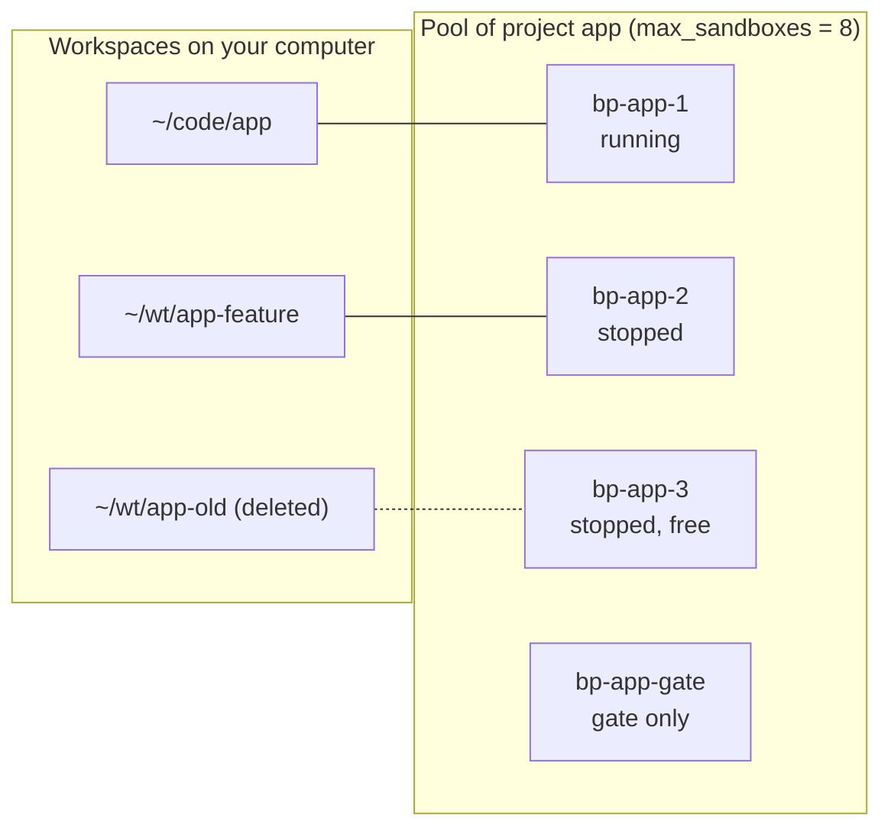
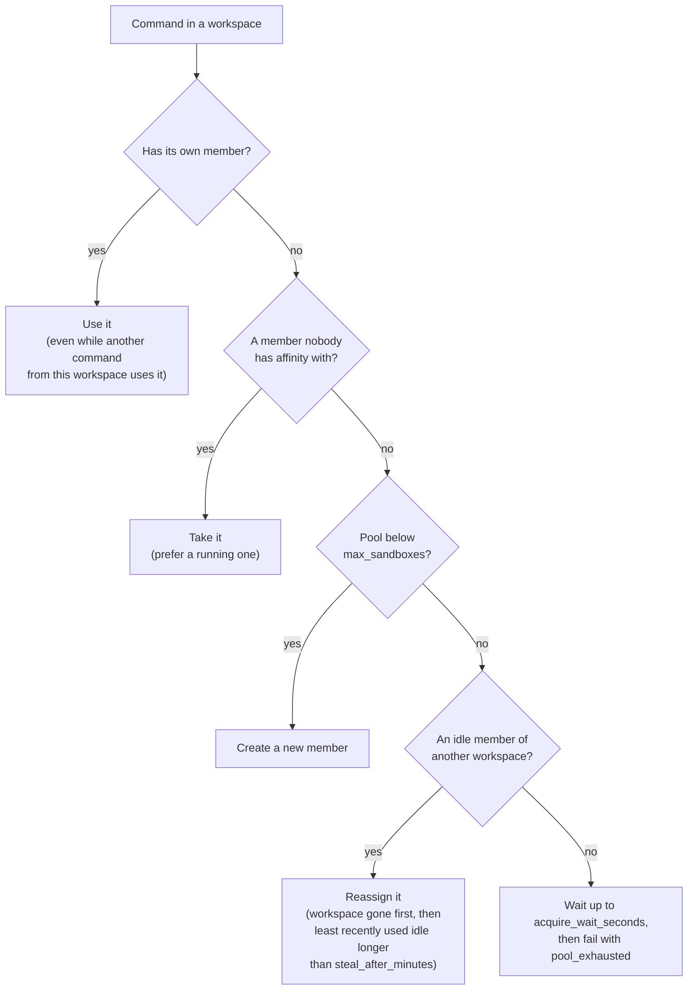
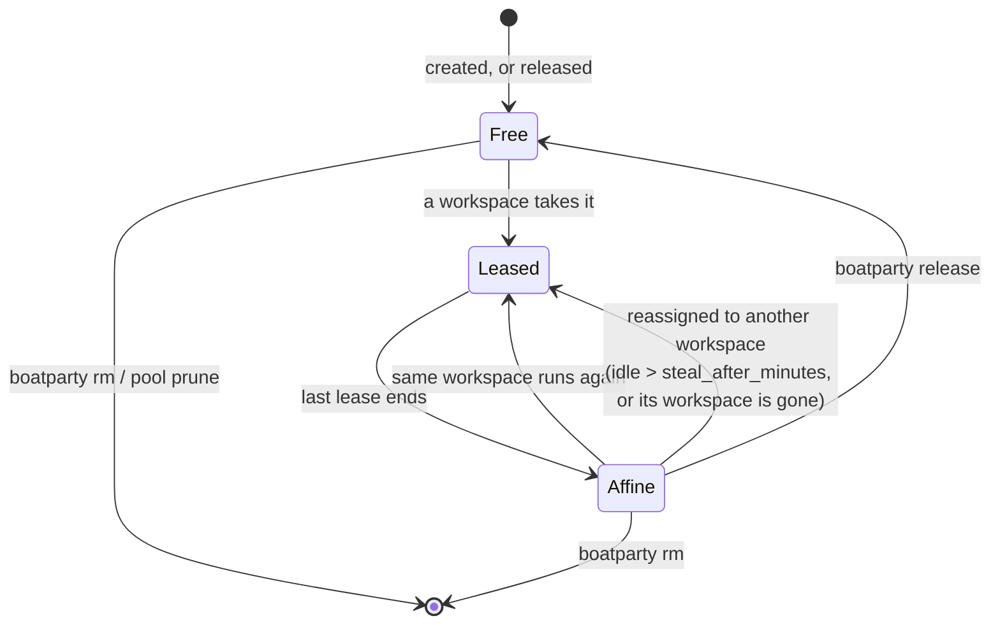

Each project owns a **pool** of sandboxes. Each checkout of the project (a **workspace**) borrows one member of that pool and keeps coming back to it, so its dependencies and build outputs stay warm. This page explains how members are chosen, shared and reclaimed.

## Pools, members and workspaces



- A **project** is named in `boatparty.toml`. Every checkout of the same repository with the same project name shares one pool.
- A **member** is one sandbox, named `bp-<project>-<n>` at boat. The pool creates members as they are needed, up to `max_sandboxes` (8 by default).
- A **workspace** is identified by its Git top-level directory. Your main checkout and each `git worktree` are separate workspaces.
- A workspace has an **affinity** with the member it used last. That member is "its" sandbox until it is released or reassigned.

## Which sandbox a workspace gets

Every command that needs a sandbox asks the pool for one. The pool decides in this order:



1. **Its own member**, the one it used last. Several commands from the same workspace can use it at once, for example a dev server and a test run.
2. **A free member**, one no workspace has an affinity with. A running one is preferred, so no start is needed.
3. **A new member**, if the pool is below `max_sandboxes`.
4. **Another workspace's idle member.** First one whose workspace directory no longer exists (a deleted worktree), then the least recently used one that has been idle for longer than `steal_after_minutes` (30 by default). Running members are preferred in both cases.
5. **Wait** for a member to become free, up to `acquire_wait_seconds` (900 by default, 15 minutes), then fail with a message naming the limit that was reached.

A member that is in use (it has a live lease) is never taken from another workspace.

### When the running cap is reached

If the project's or the account's `max_running` would be exceeded by starting another sandbox, boatparty does not start one. Instead it reuses a running member that nobody is using at that moment (a free one first, then another workspace's), regardless of how long it has been idle. If there is none, it waits for room. See [Starts, limits and costs](/docs/limits#running-sandboxes).

## Leases

A **lease** is a record that a particular boatparty process is using a member. `run` takes a *run* lease, `serve` a *serve* lease, and `shell`, `pipe`, `fetch`, `forward`, `expose`, `desktop` and `sync` a *session* lease for as long as they need the sandbox. `gate` holds its dedicated member the same way. Leases do two things:

- **They keep the sandbox awake.** While a lease is held, a heartbeat pushes the sandbox's auto-stop deadline `lease_minutes` (5) ahead every `heartbeat_minutes` (2). A long build is never stopped halfway.
- **They protect the member.** A member with a live lease is never reassigned, and `stop`, `release` and `rm` refuse to touch it, naming the process that holds it.

When the last lease on a member ends, a detached helper sets the idle deadline: the sandbox stops `idle_minutes` (5) later unless another command arrives. If a boatparty process dies without cleaning up (even with SIGKILL), its lease is recognized as dead because its process is gone, and the sandbox stops on its own after at most about `lease_minutes`.



## Looking at pools

`boatparty status` shows this project's members, with the one this workspace uses marked by `*`:

```text
project hello-api
* bp-hello-api-1       bx_d5zd8s2j  running   files complete auto-stop 2026-11-26T18:36:30.750Z for /Users/you/code/hello-api
  serve (pid 72373): npm run dev http://localhost:50135
```

`boatparty pool` shows every project on this computer:

```text
project hello-api: 2 of at most 8 sandboxes
  bp-hello-api-1       bx_d5zd8s2j  running   /Users/you/code/hello-api  used 9s ago
  bp-hello-api-gate    bx_n2mhn7r9  running   gate  used 1s ago
```

Both read boatparty's local records. `boatparty pool --refresh` first reconciles them with boat: it adopts sandboxes that carry the project's label but have no local record, drops records whose sandbox is gone, deletes sandboxes whose stored disk boat has expired, and frees members whose workspace directory no longer exists. A missing directory alone never deletes anything. `--project NAME` limits the output to one project.

## Steering by hand

You rarely need these, but they are there:

| Command | What it does |
| --- | --- |
| `boatparty release` | Let go of this workspace's member, so another workspace can use it. The sandbox keeps running or stays stopped; only the affinity record is dropped. Refused while a command is using it. |
| `boatparty assign MEMBER` | Pin a specific free member to this workspace (for example one that already has a heavy build cached). This workspace's previous member becomes free. |
| `boatparty start` | Create or resume this workspace's sandbox now, before you need it. |
| `boatparty stop [MEMBER] [--wait]` | Stop a sandbox now, keeping its disk. Refused while a command holds a lease. Rarely needed: sandboxes stop by themselves. |
| `boatparty rm [MEMBER]` | Delete a sandbox at boat and forget it. |
| `boatparty pool prune [--yes]` | Delete stopped members that no existing workspace needs, after listing them and asking. |

```bash
boatparty release
```

```text
released bp-hello-api-1 (bx_d5zd8s2j); another workspace may use it now
```

### Cleaning up after deleted worktrees

When you delete a worktree, its member stays in the pool, stopped. The next workspace that needs a sandbox will take it over (preferring exactly these members), so nothing is wasted. If you want to reclaim the space at boat, run:

```bash
boatparty pool prune
```

It lists the stopped members whose workspace is gone or that have no workspace, asks for confirmation (reading the answer from standard input), and deletes them. `--yes` skips the question. A member whose workspace still exists is never pruned.

## Special members

Two kinds of sandbox are not ordinary pool members:

- **The gate member**, `bp-<project>-gate`, is reserved for `boatparty gate`. It counts toward `max_sandboxes` and the running limits, but it is never leased to a workspace. See [Checking commits with gate](/docs/gate).
- **The base builder**, `bp-<project>-builder`, builds the project's base snapshot. It does not count toward `max_sandboxes`, is never leased to a workspace, and is stopped between builds. Its starts still go through the start ledger and count toward the running limits. See [Base snapshots](/docs/bases).

## Settings that shape the pool

All of these live in `~/.config/boatparty/account.toml`. Keys under `[defaults]` apply to every project; a project's own `[projects.NAME]` table can override the ones marked below. See [account.toml](/docs/account-file).

| Key | Default | Per project? | Meaning |
| --- | --- | --- | --- |
| `max_sandboxes` | 8 | yes | The most members a project's pool may own |
| `steal_after_minutes` | 30 | no | How long a member must be idle before another workspace may take it |
| `acquire_wait_seconds` | 900 | no | How long to wait for a free member before failing |
| `lease_minutes` | 5 (at most 5) | yes | How far ahead a running command keeps the auto-stop deadline |
| `heartbeat_minutes` | 2 | no | How often a running command pushes the deadline forward; must be less than `lease_minutes` |
| `idle_minutes` | 5 (at most 15) | yes | How long after the last command a sandbox stops |
