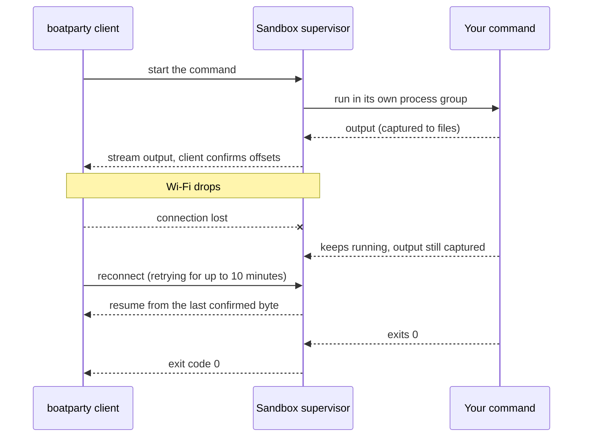
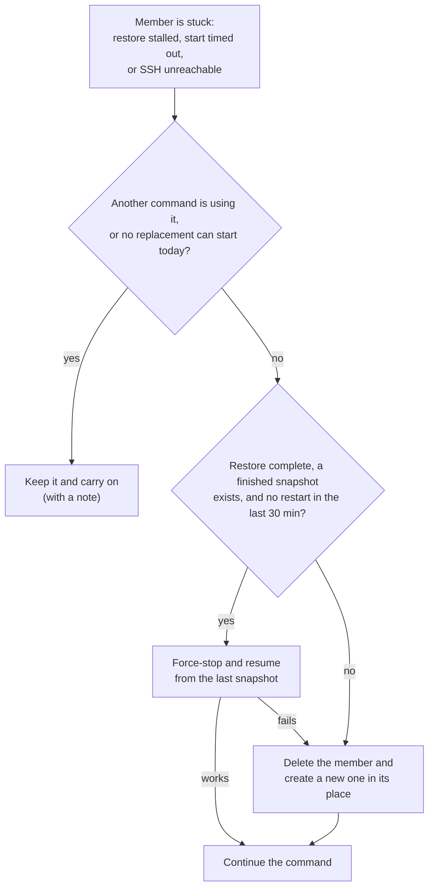

Remote machines and networks fail in ways a laptop does not: Wi-Fi drops, a sandbox resumes onto a new machine and restores its disk slowly, a machine stops answering SSH. boatparty handles the common cases by itself, and is explicit when it cannot. This page explains each case and what you will see.

The guiding principle: **a command's result is never invented.** Either boatparty reports the real exit code of the command you asked for, or it exits 125 and says why.

## When SSH drops during a run

Your command does not run inside your SSH session. On the sandbox, a supervisor process starts it in its own session and captures its output to files. Your client streams those files and confirms how much it has received.



If the connection drops:

```text
boatparty: SSH disconnected; reconnecting to the running command
```

boatparty keeps trying to reconnect for up to ten minutes. When it gets through, output resumes exactly where it stopped (nothing is repeated or lost), and the run ends normally with the command's own exit code. Ctrl-C still cancels the remote command while boatparty is reconnecting.

If your client never comes back (the laptop went to sleep, the process was killed), the supervisor stops the command's whole process group after ten minutes without contact, so nothing runs forever.

If the sandbox can no longer provide the rest of the output and the exit status, the run ends with 125 and:

```text
boatparty: error: command lost: the sandbox could not provide the remaining output and exit status; the command was not restarted
```

boatparty never re-runs a command on its own, because the command may have had side effects. Check whether it did what you wanted before running it again.

### Before the command starts

Problems before launch are safer to retry, because nothing has run yet. If an SSH session is refused while syncing, boatparty retries once. On macOS and Linux, if the shared SSH connection (the control master) has gone stale and refuses new sessions, boatparty replaces it and continues.

## When a sandbox is restoring its files

When boat resumes a stopped sandbox onto a new machine, the disk arrives lazily in the background. Files are listed immediately but their content is fetched on first access, which makes everything slow and some tools misbehave. boatparty waits for the restore to finish before syncing, and reports progress once a minute:

```text
boatparty: bp-app-1 restoring: 18233 of 22533 entries, 60s elapsed
```

While a sandbox is restoring:

- `run` and `serve` wait before syncing; `stop` waits before stopping.
- boatparty never lets the sandbox stop for idleness, and pushes its idle deadline past the restore, so the next command does not have to start over.
- A restore that makes no progress for 10 minutes, or takes longer than 30 minutes overall, is treated as **stalled** and triggers recovery (below).

### Waiting for another process

When two commands need the same sandbox and one of them is already bringing it up, the other waits instead of starting a second bring-up, and tells you what it is waiting for:

```text
boatparty: another boatparty process is starting bp-app-1; waiting for pid 48213: restoring files (limit 1800s)
```

If the process bringing it up fails, the waiting command sees the reason.

## The recovery ladder

Sometimes a sandbox is genuinely stuck: its restore stalls, it never reaches the running state, or repeated direct SSH probes fail. boatparty then marks the member as broken and climbs a ladder, using the gentlest fix that can work:



1. **Keep it** if replacing it would do more harm than good: another command still holds a lease on it, or the day's start window is full so no replacement could start. The member keeps serving commands, with a note, and is replaced at the first start that can be made.
2. **Restart from a snapshot.** If the sandbox's disk had finished restoring and boat holds a completed snapshot, boatparty force-stops it and resumes from that snapshot. This is fast and keeps almost everything, but **writes made after the snapshot can be lost**:

   ```text
   boatparty: bp-app-1 is stuck (restore stalled); force-stopping to resume from the last snapshot. Writes since that snapshot will be lost
   ```

   A snapshot restart is tried at most once per 30 minutes per member.
3. **Replace the member.** If a restart is not possible, was tried recently, or does not restore service, boatparty deletes the sandbox and creates a new one in its place, under the same name. The new member installs dependencies on its first command (or starts from the project's [base](/docs/bases), if it has one).

   ```text
   boatparty: bp-app-1 (bx_q4m8r2dn) is broken: restore stalled; deleting it and creating a new sandbox in its place
   ```

Run summaries and `--json` results report when a run went through recovery (`restarted` or `replaced`).

### Build outputs after a restart

A snapshot restart or a move to a new machine can leave build outputs partially written or pointing at paths that no longer exist. The Rust preset handles this: after a restart it removes Cargo units written close to the snapshot and units that reference a retired path, so Cargo rebuilds them instead of failing. The runner also drops compiler cache entries that a restore left unreadable. Other stacks rely on their own dependency checks (for example the Node presets check that every installed package has its files).

## When boat's tunnel is degraded

Boat reaches each sandbox through a tunnel, which hosting (`expose`) and the streamed desktop (`desktop`) depend on. boatparty's own commands use direct SSH instead, so a degraded tunnel does not stop `run`, `serve`, `shell` or `sync` at all.

`expose` and `desktop` do need the tunnel. When they find it degraded, they can repair it by rebooting the sandbox over SSH, but only when it is safe:

- no other command holds a lease on the sandbox, and
- it has not been rebooted for this reason in the last 30 minutes.

After a reboot, boatparty waits up to five minutes for the tunnel to recover. If it cannot repair it safely, the command fails with `tunnel_degraded` and explains why.

## Slow hosts

Sandboxes share physical hosts. Each run measures **CPU steal**, the share of time the sandbox wanted the CPU but the host gave it to someone else, and reports it in the summary:

```text
boatparty: bp-app-1 (bx_d5zd8s2j) exit 0 in 8.7s (prep 8.1s, 0% CPU steal)
```

At 15% or more, boatparty adds a note that the host was overloaded. Timing-sensitive tests (timeouts, benchmarks) can fail for that reason alone, so a retry later is reasonable.

Run summaries also report time spent waiting in the start queue and waiting for another process to bring the member up, so you can tell slow commands from slow infrastructure.

## What you should do

| You see | It means | Do this |
| --- | --- | --- |
| `SSH disconnected; reconnecting` | Your connection dropped; the command is still running | Nothing; wait |
| `restoring: ... entries` | The sandbox moved to a new machine and is restoring | Nothing; the first command after a move is slow |
| `is stuck ... force-stopping` or `is broken ... deleting it` | The recovery ladder is fixing a stuck sandbox | Nothing; rerun anything that depended on very recent writes on the sandbox |
| Exit 125 with `command lost` | The result is unknown | Check for side effects, then rerun |
| Exit 125, anything else | boatparty or the sandbox failed | Retry once; if it fails again, see [Troubleshooting](/docs/troubleshooting) |
