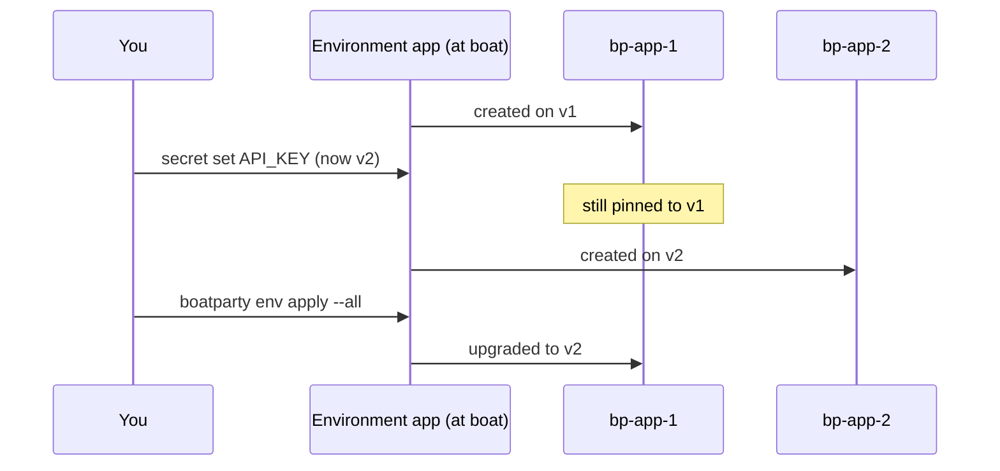

Commands on a sandbox often need configuration: a database URL, an API key for integration tests, a feature flag. boatparty offers three places for it, depending on how sensitive it is and how often it is needed.

| What | Where | Example |
| --- | --- | --- |
| Plain, non-secret settings | `[run.env]` in `boatparty.toml` (committed) | `RUST_BACKTRACE = "1"` |
| Secrets every command needs | A project **environment** at boat, managed with `boatparty secret` | `DATABASE_URL`, `STRIPE_TEST_KEY` |
| A secret one command needs once | Standard input, with `boatparty pipe` | An upload URL, a one-time token |

The rule underneath all three: **a secret never goes in a command line.** Command lines are recorded in `runs.jsonl`, shown in `boatparty log`, and visible in process lists.

## Plain settings: [run.env]

`[run.env]` exports variables to every command, step and shell on the sandbox:

```toml
[run.env]
RUST_BACKTRACE = "1"
NODE_OPTIONS = "--max-old-space-size=4096"
PATH = "$HOME/.local/bin:$PATH"
```

Values are expanded by bash in the checkout, so `$HOME`, `$PWD` and other variables work. A value that names its own variable (like `PATH` above) extends the value from earlier layers (presets) instead of replacing it. `boatparty.toml` is committed, so keep secrets out of it. See [the `[run.env]` reference](/docs/configuration#runenv).

## Project secrets: secret and environments

Boat stores secrets in **environments**: named, versioned sets of variables (and optionally secret files, repository access and more) that it makes available to sandboxes attached to them. By default, boatparty creates sandboxes **without any environment**, so none of your account's stored secrets reach a project's sandboxes unless you choose so.

### Creating a project environment

The quickest way to give a project secrets is to let boatparty create a dedicated, secrets-only environment named after the project:

```bash
boatparty secret set --create DATABASE_URL < database-url.txt
```

```text
hello-api v1: updated DATABASE_URL
```

With `--create`, when the project has no environment yet, boatparty:

1. creates a boat environment named after the project, with only secret injection enabled;
2. sets `[sandbox] environment = "hello-api"` in your `boatparty.toml` (commit this change);
3. stores the variable.

To use an environment you already manage at boat (with `boat env`), set its name yourself instead:

```toml
[sandbox]
environment = "ci"
```

### Setting, removing and listing secrets

```bash
boatparty secret set DATABASE_URL < database-url.txt
op read "op://Dev/stripe/test-key" | boatparty secret set STRIPE_KEY
boatparty secret rm STRIPE_KEY
boatparty secret list
```

```text
DATABASE_URL
STRIPE_KEY
```

- The value always comes from **standard input**, never from an argument, so it cannot leak into shell history. `secret set` refuses to read from a terminal; redirect a file or pipe it in.
- The value must be UTF-8 and is stored **exactly** as given, including a trailing newline. Use `printf '%s'` rather than `echo` if the newline matters.
- Variable names use letters, digits and underscores, starting with a letter or underscore.
- `secret list` and `env status` show **names only**, never values.

Each change creates a new version of the environment (`v1`, `v2`, ...).

Managing secrets needs the `environment.read` and `environment.write` permissions on your API key. Keys created by `boatparty login --create-key` since 0.4.0 have them; run it again if `doctor` reports a missing permission.

### Environment versions and pins

Here is the subtle part. A sandbox is **pinned** to the environment version that was current when it was created. When you change a secret, existing sandboxes keep the old version until they are upgraded:



boatparty notices the difference and warns you. `status`, `pool`, `run` and `serve` flag a member whose pin is not the latest version of the project's environment:

```text
boatparty: bp-app-1: env: app v1 (expected app v2); see boatparty env apply
```

On a warm connection, `run` compares against the last version boatparty saw, so it stays fast. After changing an environment outside boatparty (for example with `boat env`), run `boatparty env status` to refresh what boatparty knows.

### Checking and upgrading pins

```bash
boatparty env status
```

```text
bp-app-1: app v1; variables: DATABASE_URL; env: app v1 (expected app v2)
bp-app-2: app v2; variables: DATABASE_URL, STRIPE_KEY
```

`env status` lists each member with its environment, pinned version and the variable names it receives.

```bash
boatparty env apply bp-app-1    # upgrade one member
boatparty env apply --all       # upgrade every member that is behind
boatparty env apply             # upgrade this workspace's member
```

`env apply` asks boat to move each selected member to the latest version, then checks that it really moved. Two cases need more:

- **A member on a different environment** (for example after you changed `[sandbox] environment`) cannot be moved by an upgrade. It needs to be recreated.
- **Boat sometimes leaves a selected member on its old pin.** boatparty then says so and suggests the alternatives:

```text
boatparty: bp-app-1 needs recreation for a member-only change: boatparty rm bp-app-1, then rerun the command that uses it
boatparty: to upgrade every sandbox on this environment instead, run boat env upgrade app
```

Before removing a member, fetch anything on it you still need; its next command recreates it from scratch (or from the project's [base](/docs/bases)).

## One-off secrets: pipe

For a secret that one command needs once, feed it on standard input with `pipe`:

```bash
printf '%s\n' "$UPLOAD_URL" | boatparty pipe -- bash scripts/upload.sh
boatparty pipe --sh 'cat > ~/.config/app/token && chmod 600 ~/.config/app/token' < token.txt
```

The input travels inside boatparty's own connection, framed so the end of the input is not confused with the end of the client. It is never written to `runs.jsonl`, `state.json` or any boatparty message. If `boatparty pipe` dies, the sandbox stops the command within seconds even if the input was still open. See [`pipe`](/docs/running-commands#pipe-send-input-to-a-command).

## What boatparty itself keeps secret

boatparty treats these as secrets and never puts them in an argument list, a log, `state.json` or `runs.jsonl`:

- your boat API key;
- GitHub tokens (see [Git identity and GitHub access](/docs/github-access));
- signed upload and download URLs;
- `pipe` input and `secret set` values;
- `expose` and `desktop` URLs, which are printed once on stdout and never stored.

Sandboxes created without an environment do not receive your boat account's stored credentials either: the base builder, for example, is always created that way, so a saved base never contains secrets.
