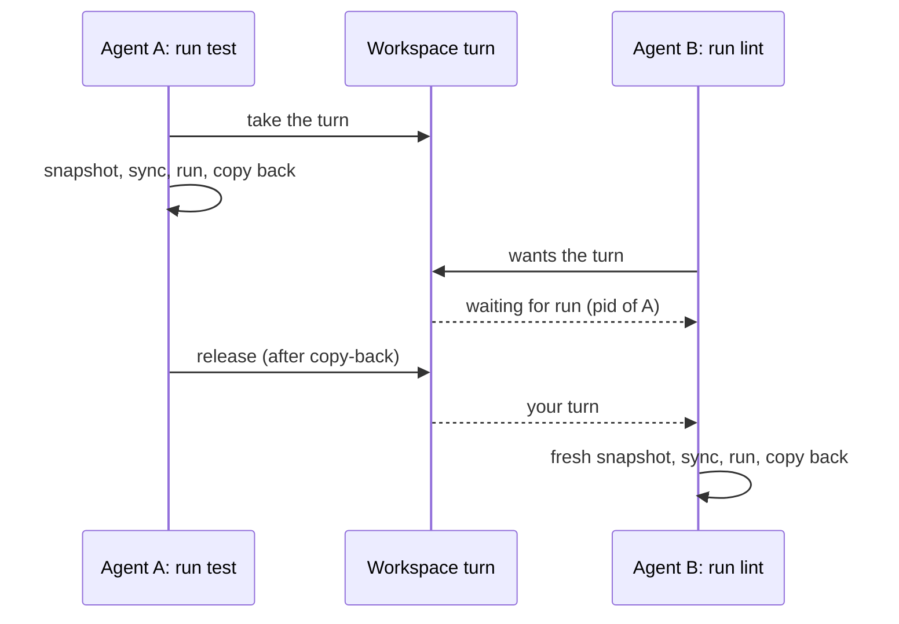

The simplest setup gives every agent its own Git worktree, and therefore its own sandbox. But it is common for two processes to share one checkout: an agent runs a dev server while another runs tests, or you open a second terminal in the same directory. boatparty makes that safe. This page explains what waits for what, and why.

## The short version

- **Runs take turns.** Two `run` commands in one workspace never overlap. The second waits until the first has finished and copied its changes back.
- **`sync` and starting a `serve` wait for a run** in progress, too.
- **A running server does not block anything.** Once a `serve` has started its server, runs, syncs and shells go ahead beside it.
- **Use `boatparty url` to find a server** another process started.
- **One server per sandbox port.** A second `serve` claiming the same port is refused and pointed at the first.
- **`gate` uses its own sandbox**, so it never waits for, or disturbs, the workspace.
- **`stop`, `release` and `rm` refuse a sandbox in use**, and name the process using it.

## Why runs take turns

A `run` is more than its command. It snapshots your working tree, syncs it to the sandbox, runs the command, then compares the result with what it sent and copies the difference back. If two runs overlapped on one checkout, each would see the other's files appear and disappear, and each would try to copy back the other's changes. Early versions of boatparty allowed this, and measurements showed exactly that: deleted files, mixed results and copy-back conflicts.

So a run holds the workspace from just before its snapshot until it has applied its changes locally. Another `run`, a `sync`, or a `serve` that is starting waits, and says what it is waiting for:

```text
boatparty: waiting for run (pid 48213)
```

When its turn comes, the waiting command takes a fresh snapshot of the working tree, so it includes any edits made while it waited.



The turn lives in a lock file on your computer, and the operating system releases it if the process holding it dies. On the sandbox, a run whose client disconnected keeps the checkout busy until its command ends or its ten-minute reconnect window expires, so a later run cannot change files under it.

## Servers run beside everything else

A `serve` takes its turn only while it starts: it waits for any run in progress, syncs, prepares, and launches the server. As soon as the server command starts, it gives the turn back. From then on:

- `run` commands go ahead, sync the checkout and run beside the server.
- `boatparty sync` pushes your edits to the checkout, so the server's file watcher reloads them.
- `shell`, `pipe` and `fetch` work as usual.

```bash
# Terminal or agent 1
boatparty serve --forward auto:3000 -- npm run dev

# Terminal or agent 2, same worktree
boatparty url 3000                 # http://localhost:50135
boatparty run -- npm test          # runs beside the server
# ...edit files...
boatparty sync                     # the server reloads the edits
```

The server and the other commands share the same checkout, including build outputs and caches. That is usually what you want (the tests see the same build), but it means a `run` that rebuilds can affect the running server. When the server ends after the checkout was re-synced under it, boatparty notes that its result may mix old and new files. For fully isolated builds, use a separate worktree.

Server-generated files are best kept in ignored directories. A sync replaces any changed tracked or untracked (non-ignored) file with your local version.

## Finding another process's server

`boatparty url` reads boatparty's local records of running servers in this workspace and prints their local URLs:

```bash
boatparty url            # every running serve forward, one per line
boatparty url 3000       # only forwards to sandbox port 3000
boatparty --json url     # with the remote port, serve pid and start time
```

It exits 1 when nothing matches, so a script can check for a server:

```bash
if url=$(boatparty url 3000); then
  echo "dev server already running at $url"
else
  echo "no dev server yet"
fi
```

A URL is published as soon as the server command launches, which can be a moment before it listens. To wait for the application itself, use the `ready` event of the `serve` that started it. `boatparty status` also lists each running server under its sandbox. See [Dev servers, ports and URLs](/docs/dev-servers-and-urls#find-a-running-servers-url-with-url).

## One server per port

If a `serve` is already serving sandbox port 3000 in this workspace, a second `serve` that wants port 3000 (as a forward, a reverse forward or a ready port) fails before doing anything, with `already_serving`:

```text
boatparty: error: port 3000 is already served for this workspace at http://localhost:50135 (pid 72373, started 41s ago); use it or stop that serve
```

The intended reaction, for agents and people alike, is to reuse the existing server's URL. To replace it, stop the process that runs the first `serve`.

Standalone `boatparty forward` tunnels are separate: they do not claim ports this way and do not appear in `url`.

## Gate has its own sandbox

`boatparty gate` checks a commit on the project's dedicated gate member, never on the workspace's sandbox. It does not take the workspace's turn, so a gate can run while a run, a sync or a server is busy in the same worktree. Only one gate runs per project at a time; a second one fails with `gate_busy`. See [Checking commits with gate](/docs/gate).

## Stop, release and remove refuse busy sandboxes

`boatparty stop`, `boatparty release` and `boatparty rm` refuse a sandbox that has a live lease (a run, a server, a shell, a forward) and exit 125 with `member_in_use`, naming the holder:

```text
boatparty: error: cannot stop bp-app-1: it is in use by pid 72373 (npm run dev); wait for those commands to finish
```

This protects one agent's server or test run from another agent's cleanup. Stop the holding process first if you really mean it.

## Choosing between sharing and separate worktrees

| Situation | Recommendation |
| --- | --- |
| Agents working on different features | One worktree each. Separate sandboxes, no waiting, isolated builds |
| One agent runs a dev server, another tests against it | Share the worktree; use `url` and `sync` |
| You want to try something in a terminal while an agent works | Share it; your runs will take turns with the agent's |
| Checking committed work before merging | `gate`, from any worktree |
