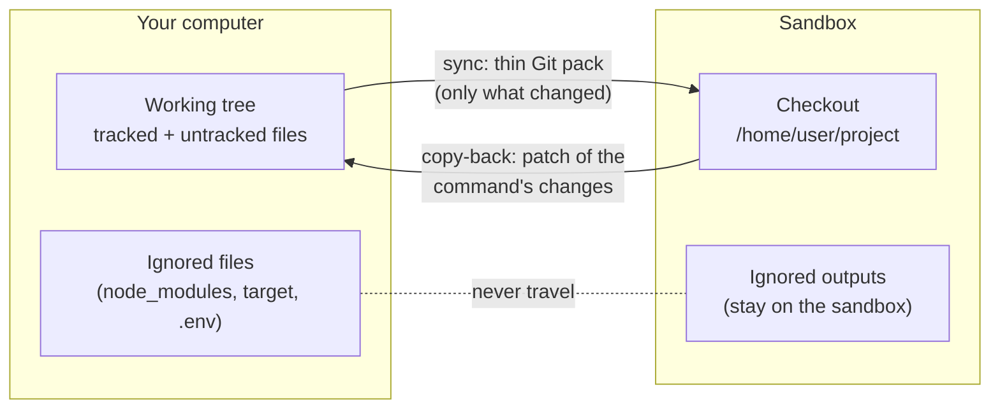

boatparty keeps two copies of your project in step: your **working tree** on your computer, and the **checkout** on the sandbox (`/home/user/<project>` by default). Before each command, your working tree is mirrored to the checkout. After the command, anything it changed in the checkout comes back to your working tree.



## What travels to the sandbox

A sync makes the sandbox's checkout identical to your working tree:

- **Tracked files**, including uncommitted edits.
- **Untracked files** that Git does not ignore, such as a new source file you have not added yet.
- **The same HEAD commit and branch**, so `git status`, `git log` and `git diff` on the sandbox show what they show locally.

What never travels:

- **Ignored files.** Anything matched by `.gitignore` (or your global excludes) stays where it is. Local `node_modules/`, `target/`, `.env` files and editor caches never leave your computer, and the sandbox's own `node_modules/` and build outputs are never overwritten or deleted by a sync.

That last point is what makes boatparty fast: the sandbox keeps its own installed dependencies and build outputs between commands, and a sync only replaces your source files.

Sync never modifies your local index or working tree. It snapshots the working tree into a private index, so it is safe to run while you are in the middle of staging a commit.

### Only changed files are rewritten

On the sandbox, the runner compares the incoming tree with the checkout and writes or deletes only the files whose content differs. Unchanged files keep their modification times, so incremental build tools (Cargo, Go, TypeScript, Make) do not see spurious changes and do not rebuild code you did not touch.

### How the files travel

Files travel as a **thin Git pack**: boatparty knows which Git objects the sandbox already has and sends only the new ones. After a one-line edit, a sync sends a few hundred bytes:

```bash
boatparty sync
```

```text
loaded main at f209b85b12 into bp-hello-api-1 (bx_d5zd8s2j) /home/user/hello-api: sent 299 B, 0.7s
```

Packs larger than 512 KiB go through a signed upload URL from boat instead of the SSH connection, which is several times faster for big changes.

### How much history travels

By default (`[sync] history = "head"`), only HEAD's commit travels, without its parents. On the sandbox, `git log` shows a single commit, and nothing larger than your current tree is ever sent. This is the right setting for almost every build and test.

Set `history = "full"` when commands on the sandbox need real history, for example a release script that reads tags or a tool that runs `git describe`. Every local branch and tag, and the default remote branch, then follow with their history.

```toml
[sync]
history = "full"
```

### Seeding from GitHub

When your repository has a GitHub remote, a brand-new sandbox does not need your computer to upload the whole project. With `[sync] seed = true` (the default), the sandbox fetches the commits GitHub already has directly from GitHub, and your computer sends only what GitHub lacks: unpushed commits and uncommitted files. On a slow home connection and a large repository, this turns a first sync from minutes into seconds.

Seeding happens:

- on a sandbox's first sync, and
- again when HEAD moved to pushed commits that the sandbox lacks and they add up to 8 MiB or more (a large pull, or a switch to a distant branch). Below that size, sending the difference directly is faster than a fetch from GitHub.

A sync whose HEAD did not move never seeds. A failed or slow fetch falls back to sending everything, so seeding never makes a sync fail. For private repositories the sandbox needs a GitHub token for that one fetch; see [Git identity and GitHub access](/docs/github-access).

### Keeping the sandbox's repository small

Every sync adds a pack to the sandbox's repository. The runner rolls packs together as they accumulate, and once a day prunes objects no ref needs any more (old snapshots and results), so the repository on a long-lived sandbox stays bounded.

## What comes back: copy-back

After a `run`, the runner compares the checkout with the tree it received and sends back the difference as a binary-safe patch. boatparty applies it to your working tree:

```text
boatparty: applied the command's changes locally: package-lock.json
```

Copy-back includes new files, modified files and deleted files, as long as they are not ignored. This is what makes these workflows feel local:

- `cargo fmt`, `prettier --write` or `ruff format` reformat your files, and the edits appear locally.
- `npm install some-package` updates `package.json` and `package-lock.json`.
- A code generator writes new source files.
- A snapshot test updates its snapshots.

Patches larger than 512 KiB come back through a signed download URL instead of SSH.

Turn copy-back off for a project with:

```toml
[sync]
copy_back = false
```

### When a change conflicts with your edits

You can keep editing while a command runs. If the command and you both changed the same lines of the same file, boatparty does not guess. It leaves your working tree untouched and keeps the command's patch inside your Git directory:

```text
boatparty: CONFLICT: the command changed greet.js but the local copy changed too; nothing was changed locally and the patch is kept at /Users/you/code/hello-api/.git/boatparty-pullback-1795717954926.patch (error: patch failed: greet.js:1
error: greet.js: patch does not apply)
```

The command's exit code is unaffected. To look at or apply the patch yourself:

```bash
git apply --stat .git/boatparty-pullback-1795717954926.patch   # what it changes
git apply --3way .git/boatparty-pullback-1795717954926.patch   # merge it with your edits
```

Changes to different files, or to different parts of the same file, apply normally.

### Which commands copy back

| Command | Copies back? |
| --- | --- |
| `run` | Yes, after every command |
| `serve` | Only when the server exits by itself. A server stopped with Ctrl-C sends nothing back, and the next sync replaces those files |
| `gate` | Never into your working tree. Edits are saved as a patch file instead (see [gate](/docs/gate)) |
| `pipe`, `shell` | No. Their changes stay on the sandbox, and the next sync replaces changed tracked and non-ignored files |
| `sync` | Nothing runs, so there is nothing to copy back |

## Getting build outputs back

Build outputs usually live in ignored directories (`target/`, `dist/`, `build/`), so they never come back by themselves. Fetch them explicitly:

```bash
boatparty fetch dist/build-info.json
```

```text
fetched /home/user/hello-api/dist/build-info.json from bp-hello-api-1 (bx_d5zd8s2j) to /Users/you/code/hello-api/build-info.json: 1 file, 37 bytes, 0.7s
```

`fetch` copies a file or a whole directory. A relative path is resolved in the sandbox's checkout; an absolute path can point anywhere on the sandbox. It does not sync first. See [`fetch`](/docs/commands#fetch) for the destination rules.

```bash
boatparty fetch target/release/app ./app-linux      # under a new name
boatparty fetch coverage/ out/                      # a directory, into out/
boatparty fetch /tmp/report.html .                  # an absolute path on the sandbox
```

Remember the sandbox is Linux x86_64: a binary built there runs on Linux, not on your Mac or Windows PC.

## Running sync on its own

`boatparty sync` mirrors your working tree without running anything. It is most useful with a running dev server: after editing locally, `sync` pushes the changes so the server's file watcher can reload. See [Dev servers, ports and URLs](/docs/dev-servers-and-urls#send-edits-to-a-running-server).

Sync waits for a run in the same workspace to finish first, so it never changes files under a running command. [Sharing a workspace](/docs/sharing-a-workspace) explains the turn-taking.

## Build outputs and timestamps

Two `[build]` settings help build tools across stops and restores:

- `output_dirs` names directories holding build outputs (the `rust` preset sets `["target"]`). With `floor_mtimes = true`, the runner rounds their modification times down to whole seconds after each command, so a restore that truncates timestamps does not make the build tool think everything changed.
- `cache_dirs`, `cache_max_age_days` and `min_free_gb` keep compiler caches inside those directories from filling the disk. See [the `[build]` reference](/docs/configuration#build).
